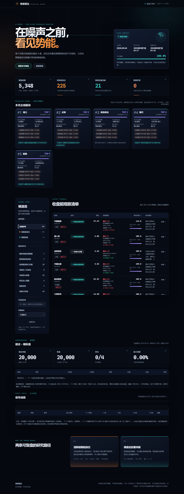

# A 股收盘前信号监测（研究预警版）

> 每个交易日 15:10 自动更新。

[🔗 在线演示（GitHub Pages）](https://huhuihu656.github.io/ashare-radar/) · [⭐ Star](https://github.com/huhuihu656/ashare-radar) · [📌 使用说明](#安装)



在每个 A 股交易日 **15:10（北京时间，收盘后）** 扫描全市场可获取 A 股行情，生成两类候选池：

1. **回踩上涨启动位**：价格处于短中期下跌结构，接近最近一段有效上涨的起涨低点；这是潜在支撑观察，不是抄底结论。
2. **横盘放量突破**：此前 20 个交易日低波动横盘，当前量能显著高于基线且接近/突破区间上沿；“资金进入”在默认免费数据源中仅由量价代理，不应解读为主力资金的确定事实。

它只生成研究信号，**不会下单或连接券商**。所有阈值都在 `config.yaml` 中，结果含每个指标，方便复盘、回测和人工确认。

## 数据源（Tushare Pro 付费优先）

扫描器以 **Tushare Pro** 为主要数据源（token 存本机 `.tushare_token`，不入库）：

- **历史日线**：按交易日批量拉取全市场 `daily` + `adj_factor`，手动前复权（与官方 qfq 逐点一致），首次全市场 320 天重建约 5 分钟，之后每日增量刷新近即时。
- **主力资金流**：`moneyflow` 全市场真实净流入，标注到每条候选信号（净流入/流出 X 亿元）。
- **交易日历 / 大盘指数**：`trade_cal` / `index_daily`。
- **仅存实时盘中快照**（14:40 扫描的当日价格/量）来自免费实时行情源——Tushare 无盘中全市场接口，这是付费源无法覆盖的一环；当日收盘后的正式数据全部来自 Tushare。

免费源（新浪/腾讯/东财）降级为最终回退：任一环节失败不中断扫描，报告如实标注。token 缺失或积分不足时自动回到纯免费模式。

## 访问与可靠性

- **主站**：https://huhuihu656.github.io/ashare-radar/ （GitHub Pages）
- **备用镜像**（国内 CDN，主站不可达时使用）：https://cdn.jsdelivr.net/gh/huhuihu656/ashare-radar@main/docs/index.html
- 站点内置 Service Worker：首次访问后，静态资源离线可用；数据文件网络失败时自动回退到最近缓存（页面标注数据时间），任何网络条件下不白屏。
- PC / 移动端自适应（含刘海屏安全区适配）。

## 安装

```powershell
cd C:\Users\45908\Documents\Codex\2026-09-04\20-a
python -m venv .venv
.\.venv\Scripts\Activate.ps1
pip install -e .
Copy-Item config.example.yaml config.yaml
```

## 扫描

```powershell
ashare-monitor scan --config config.yaml
# 首次或数据源临时不可用时，先检查可读取的股票数量
ashare-monitor universe
```

结果写入 `data/reports/YYYYMMDD/`：

- `signals.csv`：按分数排序的候选池和解释指标；
- `signals.json`：供企业微信、飞书或其他程序读取；
- `run.json`：覆盖范围、失败股票及运行配置，用于审计。

首次全市场历史数据下载耗时较长。缓存会保存历史日线，随后每次扫描只在本地复用，仍会用实时快照构造“今日未收盘”的临时 K 线。免费公共数据源可能限流或延迟；生产环境建议换成有授权的实时行情与逐笔/资金流数据源。

## 每交易日 15:10 自动运行（Windows 任务计划程序）

建议直接在 PowerShell 执行（会创建/覆盖当前账户的同名任务）：

```powershell
.\scripts\install-schedule.ps1
```

或使用“创建基本任务”，触发器设为工作日 14:40，操作填：

```text
程序/脚本: C:\Users\45908\Documents\Codex\2026-09-04\20-a\.venv\Scripts\ashare-monitor.exe
添加参数: scan --config C:\Users\45908\Documents\Codex\2026-09-04\20-a\config.yaml
起始于: C:\Users\45908\Documents\Codex\2026-09-04\20-a
```

任务计划无法识别中国交易日：本程序会查询 A 股交易日历；非交易日或无法核验日历时会安全退出，不会伪造信号。午间/实时行情异常仍需人工核验。

## 规则与风控

| 信号 | 必要条件 | 失效/注意点 |
|---|---|---|
| 清晰上升趋势 | 收盘 > MA20 > MA60，MA20 近 10 日上行，60 日涨幅 ≥ 10%，偏离 MA20 ≤ 8%（`clear_uptrend.*`）；60 日效率比 ER ≥ 0.18、日涨跌 p95 < 7%、最大回撤 > -15%；近 20 日涨停 ≤ 1 次 | 只叠 6 个月涨幅上限，不叠低位闸门；收盘跌破 MA20 即趋势结构破坏 |

## K线多粒度（后端聚合，前端渲染）

详情弹窗 K 线提供 **日 / 周 / 月** 三档切换。聚合在服务端（`scripts/export_dashboard.py`）每次扫描时一次性完成：

- 日线：近 90 个交易日；
- 周线：ISO 周分组（首日开 / 最高高 / 最低低 / 末日收 / 量求和），近 64 周；
- 月线：自然月分组，近 48 个月。

前端直接接收结构化 JSON（`docs/data/klines.json` v2，`series.day/week/month`）只做渲染，不在应用层循环聚合明细。

## 参考仓位策略（研究参考，非投资建议）

每条信号附一个可审计的仓位档位，推导全程透明、逐因子记录在 `position_reason`：

1. **基础仓位**由信号分数分档：≥80 分 30% / ≥60 分 20% / ≥40 分 10% / 其余 5%；
2. **大盘环境**系数：偏强 ×1.0、中性 ×0.7、偏弱/未知 ×0.5；
3. **主力资金流**系数：净流入 ×1.2、净流出 ×0.8、无数据 ×1.0；
4. 结果落到 5% 档位网格，**单票上限 30%**。

档位：重点观察（≥25%）/ 标准观察（≥15%）/ 轻仓跟踪（≥10%）/ 仅跟踪。仓位仅为研究参考，不构成投资建议。

## 买卖点计划（研究参考，非投资建议）

每条信号附机械推导的交易计划，全部来自形态自身结构：

- **买入参考价** = 当天收盘价（趋势确认即买入）；
- **止损价** = MA20 × 0.97（收盘跌破 MA20 即趋势结构破坏）；
- **止盈价** = 风险收益比 **1:3** 目标；
- 每行同时给出 **触发状态**（现价是否已过确认位）与 **计划依据**，下单前可对照执行。

计划是规则推导的参考价位，不是收益保证；实盘仍需结合流动性、滑点与仓位上限。

## 共性风控（位置 / 市场环境）

1. **位置**：6 个月内涨幅 > 100% 一律失效（`risk.max_position_gain_pct`）。
   本信号**不叠 120 日低位分位**——它要求价格处于上升结构，低位闸门与定义直接冲突。
2. **市场环境**：每次扫描读取上证指数并标注 偏强/中性/偏弱，**只作标注、不拦截**；
   可选 `risk.weak_market_skip_signals: true`（默认 false）是全局开关，开启后大盘单边下跌时丢弃全部信号。


技术形态是概率工具而非确定性预言；单一形态胜率不会长期稳定超过 85%，需以形态为引子、量能为验证、趋势为背景。

不把回测表现当作未来收益。投入任何资金前，应补充复权一致性、停复牌/涨跌停处理、滑点、手续费、幸存者偏差控制，以及样本外滚动验证。
